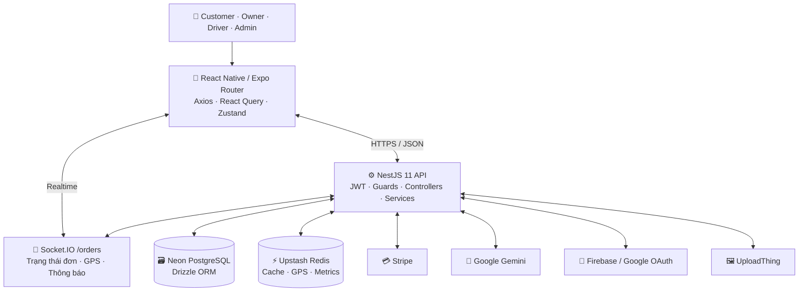
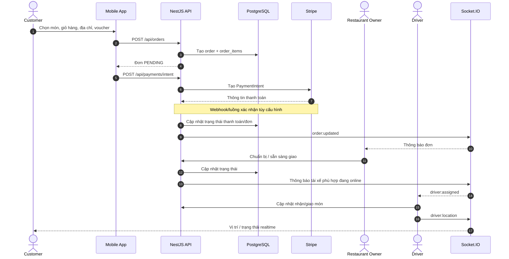
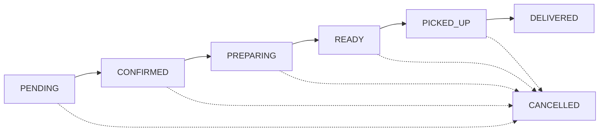
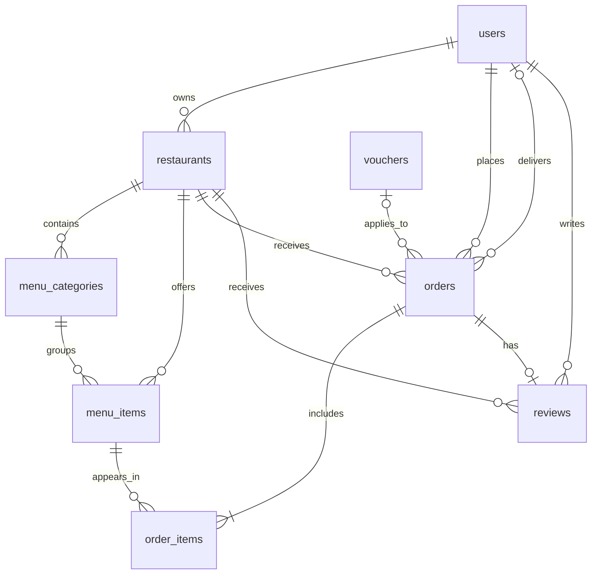

<div align="center">


# 🍽️ DeliFood

### Ứng dụng đặt món & giao đồ ăn đa vai trò, theo dõi đơn hàng thời gian thực

**React Native · Expo · NestJS · PostgreSQL · Redis · Socket.IO · Gemini AI**


</div>

---

## 🌟 Giới thiệu

**DeliFood** là ứng dụng đặt và giao đồ ăn xây dựng bằng **React Native/Expo** kết hợp **NestJS REST API**. Dự án kết nối bốn nhóm người dùng trong một ứng dụng có điều hướng và màn hình phù hợp với từng vai trò:

| Vai trò | Mục tiêu |
|:--|:--|
| 🛍️ **Customer** | Khám phá nhà hàng, chọn món, đặt hàng, thanh toán và theo dõi giao hàng. |
| 🏪 **Restaurant Owner** | Quản lý nhà hàng, thực đơn, đơn đặt món và thống kê. |
| 🛵 **Driver** | Bật/tắt trạng thái hoạt động, nhận chuyến, giao hàng và cập nhật vị trí. |
| 🛡️ **Admin** | Quản lý tài khoản, nhà hàng, voucher và theo dõi hoạt động hệ thống. |

Ngoài nghiệp vụ đặt món, dự án triển khai **Socket.IO cho sự kiện realtime**, **Upstash Redis để cache và lưu vị trí GPS tạm thời**, **Stripe cho luồng thanh toán**, **Google Gemini cho chatbot Deli** và **dashboard monitor** của Backend.

## ✨ Chức năng chính

<details open>
<summary><b>🛍️ Customer — Khách hàng</b></summary>

- Đăng ký, đăng nhập bằng **email/mật khẩu** hoặc **Google**; lưu phiên đăng nhập bằng JWT.
- Xem danh sách nhà hàng, tìm kiếm, xem danh mục và món ăn chi tiết.
- Thêm món vào giỏ hàng, điều chỉnh số lượng và ghi chú, lựa chọn voucher hợp lệ.
- Tạo đơn hàng, nhập địa chỉ giao, thực hiện luồng thanh toán trực tuyến qua Stripe.
- Xem lịch sử, trạng thái đơn; theo dõi vị trí tài xế trên bản đồ khi có dữ liệu.
- Hủy đơn và ghi nhận lý do theo luồng trạng thái hiện tại; đánh giá đơn sau khi hoàn thành.
- Trò chuyện với **Deli**, trợ lý AI gợi ý nhà hàng, món ăn và mã khuyến mãi.

</details>

<details>
<summary><b>🏪 Restaurant Owner — Chủ nhà hàng</b></summary>

- Tạo/chỉnh sửa thông tin nhà hàng và trạng thái hoạt động.
- Quản lý danh mục món ăn, thêm/sửa/xóa món, giá bán, ảnh và trạng thái còn hàng.
- Xem và xử lý đơn của nhà hàng; cập nhật các bước chuẩn bị và sẵn sàng giao.
- Xem trang thống kê và thông tin tài khoản, điều hướng riêng cho Owner.

</details>

<details>
<summary><b>🛵 Driver — Tài xế / Shipper</b></summary>

- Chuyển trạng thái **Online/Offline** và nhận thông báo đơn được phân công.
- Xem đơn được giao, từ chối chuyến trong luồng được hỗ trợ, quản lý đơn đang giao.
- Cập nhật tiến trình nhận món/giao hàng; gửi vị trí GPS đến Backend.
- Xem lịch sử chuyến giao và hồ sơ cá nhân.

</details>

<details>
<summary><b>🛡️ Admin — Quản trị hệ thống</b></summary>

- Tổng quan số liệu hoạt động; quản lý người dùng và trạng thái khóa tài khoản.
- Quản lý nhà hàng và tài xế trong phạm vi quyền quản trị.
- Tạo, xem và thay đổi trạng thái voucher.
- Truy cập trang theo dõi kỹ thuật **`/monitor`** để xem các chỉ số Backend (phần dữ liệu cần quyền Admin).

</details>

## 💬📞 Nhắn tin và gọi điện giữa Driver – Customer

### Mục đích và trải nghiệm 

Khi đơn hàng đã có tài xế được phân công, Customer và Driver có thể chủ động liên hệ để xác nhận địa chỉ, hướng dẫn điểm nhận hàng hoặc xử lý tình huống khó tìm vị trí giao.

| Vai trò | Giao diện liên hệ | Tác vụ |
|---|---|---|
| 🛍️ **Customer** | Chi tiết đơn hàng đang giao | Chọn **Nhắn tin tài xế** hoặc **Gọi tài xế** để trao đổi về địa chỉ và thời điểm nhận món. |
| 🛵 **Driver** | Màn hình đơn đang giao | Chọn **Nhắn tin khách hàng** hoặc **Gọi khách hàng** khi cần hướng dẫn đường đi hoặc xác nhận điểm giao. |

**Luồng trao đổi đề xuất:**

1. Hệ thống kiểm tra đơn hàng có tài xế đã nhận chuyến và người dùng hiện tại là **Customer/Driver của chính đơn đó**.
2. Nếu chọn **Nhắn tin**, ứng dụng mở hội thoại gắn với `orderId`; các tin nhắn được gửi/nhận gần thời gian thực, hiển thị thời điểm gửi và trạng thái gửi cơ bản.
3. Nếu chọn **Gọi**, ứng dụng khởi tạo cuộc gọi đến số liên hệ được phép hiển thị; trên thiết bị di động có thể mở ứng dụng điện thoại mặc định. **Chưa có gọi VoIP trong ứng dụng** ở bản mã nguồn hiện tại.
4. Khi đơn hoàn thành hoặc bị hủy, quyền liên hệ trực tiếp cần được giới hạn hoặc đóng theo quy tắc nghiệp vụ của nhóm để bảo vệ thông tin cá nhân.

## 🏗️ Kiến trúc hệ thống

DeliFood sử dụng **monorepo pnpm** theo kiến trúc **Mobile Client → NestJS API → các dịch vụ dữ liệu**. Frontend không kết nối PostgreSQL trực tiếp.



### Công nghệ và lý do lựa chọn

| Tầng | Công nghệ trong mã nguồn | Vai trò |
|---|---|---|
| Mobile | **Expo SDK 55, React Native 0.83, React 19, TypeScript** | Phát triển giao diện đa nền tảng, tái sử dụng component, kiểm tra kiểu dữ liệu. |
| Navigation | **Expo Router, React Navigation** | Tổ chức màn hình theo file và theo nhóm quyền. |
| Client state & data | **Zustand, TanStack React Query, Axios** | Giỏ hàng, truy vấn dữ liệu có cache phía client và gọi REST API. |
| Backend | **NestJS 11, Express adapter** | Controller–Service–Module, kiểm tra dữ liệu và phân quyền. |
| Database | **Neon PostgreSQL + Drizzle ORM** | Lưu dữ liệu quan hệ; truy vấn có kiểu TypeScript. |
| Realtime | **Socket.IO** | Cập nhật trạng thái đơn hàng, phân công tài xế, vị trí giao hàng. |
| Cache / ephemeral | **Upstash Redis** | Cache dữ liệu và lưu tọa độ GPS với thời hạn. |
| Auth | **JWT, Firebase, Google OAuth** | Xác thực người dùng; kiểm tra role bằng Guard. |
| Payment | **Stripe PaymentIntent / PaymentSheet / Webhook** | Xử lý luồng thanh toán thẻ trong môi trường cấu hình phù hợp. |
| AI | **Google Gemini (`@google/genai`)** | Chatbot Deli với Function Calling truy vấn dữ liệu thật. |
| Media | **UploadThing** | Tải ảnh cho các màn hình hỗ trợ upload. |

## 🗂️ Tổ chức source code

```text
DeliveryFood/
├── apps/
│   ├── mobile/                      # 📱 Frontend React Native / Expo
│   │   ├── src/
│   │   │   ├── app/
│   │   │   │   ├── (customer)/      # Home, Search, Cart, Orders, AI Chat...
│   │   │   │   ├── (owner)/         # Nhà hàng, Menu, Analytics, Profile
│   │   │   │   ├── (driver)/        # Nhận chuyến, Đang giao, Lịch sử, Profile
│   │   │   │   ├── (admin)/         # Dashboard, Users, Restaurants, Vouchers
│   │   │   │   ├── login.tsx
│   │   │   │   └── register.tsx
│   │   │   ├── components/         # UI và thành phần tái sử dụng
│   │   │   ├── context/            # Context xác thực
│   │   │   ├── hooks/              # Logic dùng lại, Socket.IO, debounce...
│   │   │   ├── store/              # Zustand
│   │   │   └── lib/                # Axios, Firebase, UploadThing...
│   │   ├── assets/                 # Logo, icon, hình ảnh
│   │   ├── app.config.ts           # Cấu hình Expo/EAS
│   │   └── package.json
│   └── api/                         # ⚙️ Backend NestJS
│       ├── src/
│       │   ├── auth/              # JWT, login, Google, role guards
│       │   ├── restaurants/       # Nhà hàng
│       │   ├── menu/              # Danh mục và món ăn
│       │   ├── orders/            # Đặt món, trạng thái, hủy đơn
│       │   ├── payments/          # Stripe PaymentIntent, confirm, webhook
│       │   ├── driver/            # Trạng thái tài xế, phân công, từ chối
│       │   ├── gateway/           # Socket.IO namespace /orders
│       │   ├── location/          # Lưu/đọc GPS qua Redis
│       │   ├── vouchers/          # Mã giảm giá
│       │   ├── reviews/           # Đánh giá
│       │   ├── chat/              # Gemini và tool tra cứu dữ liệu
│       │   ├── admin/             # Quản trị
│       │   ├── cache/             # Redis cache
│       │   ├── monitor/           # API metrics, trang monitor
│       │   ├── db/schema/         # Drizzle schema (PostgreSQL)
│       │   └── uploadthing/       # Upload ảnh
│       ├── drizzle.config.ts
│       └── package.json
├── packages/
│   └── types/                      # 📦 @food-delivery/types
│       ├── index.ts               # Shared role, DTO/interface, order status
│       └── package.json
├── pnpm-workspace.yaml
├── pnpm-lock.yaml
├── package.json
└── README.md
```

### 📦 Vì sao có `packages/types`?

Package **`@food-delivery/types`** được Mobile và API cùng sử dụng, giúp các vai trò (`UserRole`), trạng thái đơn (`OrderStatus`) và kiểu dữ liệu (`User`, `RestaurantType`, `MenuItem`, `Order`, `Voucher`...) nhất quán.

Ví dụ trong code:

```ts
import { UserRole, OrderStatus } from '@food-delivery/types';

const role = UserRole.RESTAURANT_OWNER;
const status = OrderStatus.PREPARING;
```

**Quan trọng:** package này khai báo `main: ./dist/index.js`; sau khi clone và `pnpm install`, cần chạy `pnpm build:types` trước khi khởi động ứng dụng để tránh lỗi **`Unable to resolve @food-delivery/types`**.

## 🔁 Luồng xử lý đặt và giao món



Các trạng thái được khai báo trong shared types:



> Biểu đồ là mô tả tổng quan vòng đời trạng thái trong code, **không có nghĩa mọi thao tác chuyển trạng thái đều được phép cho mọi vai trò**. Điều kiện hủy/nhận hàng và phân quyền do nghiệp vụ trong `OrdersService` quyết định.

## 🗃️ Cơ sở dữ liệu

Backend sử dụng **PostgreSQL trên Neon** và **Drizzle ORM**. Các schema nằm tại [`apps/api/src/db/schema`](./apps/api/src/db/schema).

**8 bảng hiện có trong mã nguồn:**

| Bảng | Dữ liệu chính | Liên kết tiêu biểu |
|---|---|---|
| `users` | Thông tin người dùng, role, trạng thái online/blocked | Người dùng có thể sở hữu nhà hàng, đặt/giao đơn |
| `restaurants` | Tên, địa chỉ, loại ẩm thực, trạng thái, rating | `owner_id → users.id` |
| `menu_categories` | Danh mục món của nhà hàng | `restaurant_id → restaurants.id` |
| `menu_items` | Món ăn, giá, ảnh, trạng thái còn hàng | `category_id`, `restaurant_id` |
| `orders` | Khách, nhà hàng, tài xế, trạng thái, số tiền, địa chỉ, voucher | `customer_id`, `restaurant_id`, `driver_id`, `voucher_id` |
| `order_items` | Món, số lượng, đơn giá tại thời điểm đặt | `order_id`, `menu_item_id` |
| `reviews` | Sao/bình luận nhà hàng và tài xế | `order_id` (duy nhất), `customer_id`, `restaurant_id` |
| `vouchers` | Mã giảm giá, điều kiện áp dụng, thời hạn, giới hạn dùng | `created_by → users.id` |




## 🔌 REST API & Realtime

Backend đặt prefix **`/api`** cho phần lớn REST endpoint. Ví dụ khi chạy local trên cổng 3000: `http://localhost:3000/api`.

| Nhóm | Một số endpoint từ controller | Mục đích |
|---|---|---|
| Auth | `POST /api/auth/register`, `/login`, `/google`; `GET /api/auth/me` | Đăng ký, đăng nhập, xác thực |
| Restaurants | `GET /api/restaurants`, `GET /api/restaurants/:id`, `GET /api/restaurants/mine`, `POST /api/restaurants` | Tìm/xem/quản lý nhà hàng |
| Menu | `GET /api/menu/categories`, `GET /api/menu/items/:restaurantId`, `POST /api/menu/items`, `PATCH /api/menu/items/:id` | Danh mục, món ăn |
| Orders | `POST /api/orders`, `GET /api/orders/mine`, `GET /api/orders/restaurant`, `PATCH /api/orders/:id/status` | Tạo/tra cứu/xử lý đơn |
| Payments | `POST /api/payments/intent`, `/confirm`, `/webhook` | Tích hợp thanh toán Stripe |
| Driver | `PATCH /api/driver/online`, `GET /api/driver/status`, `POST /api/driver/orders/:id/decline` | Trạng thái/chuyến giao |
| Location | `GET /api/location/:orderId` | Lấy vị trí tài xế được lưu tạm |
| Reviews | `POST /api/reviews`, `GET /api/reviews/restaurant/:restaurantId` | Đánh giá |
| Vouchers | `GET /api/vouchers/available`, `GET /api/vouchers/latest`, `POST /api/admin/vouchers` | Khuyến mãi |
| Chatbot | `POST /api/chat` | Hội thoại với Deli AI (Customer) |
| Admin | `GET /api/admin/overview`, `/users`, `/restaurants` | Quản trị |
| Monitoring | `GET /monitor`, `GET /monitor/data` | Dashboard; dữ liệu metrics yêu cầu JWT Admin |

Các API cần xác thực gửi token theo dạng:

```http
Authorization: Bearer <ACCESS_TOKEN>
```

**Socket.IO:** namespace **`/orders`** hỗ trợ các event `join:order`, `join:restaurant`, `join:driver`, `order:updated`, `driver:assigned` và `driver:location`. Ngoài việc lấy vị trí realtime, client có thể gọi API location để hiển thị tọa độ gần nhất khi vừa mở màn hình theo dõi.


## ⚡ Điểm nhấn kỹ thuật: Redis, GPS, Performance và AI

| Thành phần | Cách hiện thực trong code | Giá trị cấu hình / lưu ý |
|---|---|---|
| **Redis Cache** | `CacheService` với `get`, `set`, `del`; danh sách nhà hàng/thực đơn có cache và cơ chế cập nhật cache. | TTL mặc định **300 giây**. |
| **GPS realtime** | Driver gửi `driver:location`; Gateway phát đến room của đơn và `LocationService` lưu vị trí. | Redis key `driver:location:<orderId>`, TTL **3.600 giây**. |
| **Socket.IO** | Push trạng thái đơn và phân công tài xế không cần liên tục tải lại API. | Namespace `/orders`. |
| **Debounce** | Hook `useDebounce` tại các màn hình tìm kiếm; giỏ hàng cũng debounce giá trị để xét voucher. | Tìm kiếm khoảng **300–350 ms**, voucher **400 ms** tùy màn hình. |
| **API Monitor** | Middleware đo thời gian request, mã trạng thái, số lượng kết nối; dữ liệu kỹ thuật hiển thị qua trang monitor. | Có histogram/ước lượng phân vị; đây **không phải benchmark đã kiểm thử tải**. |
| **Deli AI** | Google Gemini và Function Calling truy vấn dữ liệu nhà hàng, món ăn, voucher thực tế. | Không tự tạo đơn hay thanh toán thay khách. |

### 🤖 Deli — AI Food Advisor

Trợ lý AI được triển khai tại `apps/api/src/chat/`:

1. Customer gửi tin nhắn đến `POST /api/chat`.
2. `ChatService` gọi **Google Gemini** với hướng dẫn trả lời liên quan tới đồ ăn.
3. Khi cần dữ liệu, Gemini gọi function trong `ChatToolsService` để tra cứu **best seller, nhà hàng đánh giá cao, tìm kiếm món, khu vực và voucher**.
4. Backend trả lời kèm thẻ món/nhà hàng phù hợp với dữ liệu đã tra cứu.

Chatbot giới hạn số tin nhắn theo cửa sổ thời gian trong bộ nhớ tiến trình; chức năng “gần đây” dùng thông tin khu vực/địa chỉ chứ **không bảo đảm khoảng cách GPS chính xác**.

> **Phân biệt:** `POST /api/chat` là chatbot Deli sử dụng Gemini, **không phải API nhắn tin giữa Customer và Driver**. Xem [định hướng liên hệ trực tiếp](#-nhắn-tin-và-gọi-điện-giữa-driver--customer).

## 🚀 Cài đặt và chạy project

### 1. Yêu cầu môi trường

- **Git**, **Node.js** phiên bản tương thích với Expo SDK 55/NestJS 11 (nên dùng một bản LTS được nhóm thống nhất).
- **pnpm `12.9.1`** theo khai báo `packageManager` ở thư mục gốc.
- Android Studio/Android Emulator hoặc thiết bị Android/iOS, hay Expo Development Build khi dùng module native.
- Tài khoản và cấu hình dịch vụ tương ứng: **Neon**, **Upstash Redis**, **Firebase/Google OAuth**, **Stripe**, **UploadThing**, **Gemini** (với chức năng AI).

### 2. Clone và cài thư viện

```bash
git clone https://github.com/Oanhcute-afk/DeliveryFood.git
cd DeliveryFood

# Kiểm tra môi trường
node -v
pnpm -v

# Nếu chưa có pnpm: dùng npm/Corepack tùy cấu hình máy
npm install -g pnpm@12.9.1

# Cài dependencies của toàn bộ workspace
pnpm install

# Build kiểu dữ liệu dùng chung trước khi chạy
pnpm build:types
```

Không cần sao chép `node_modules` từ máy khác. `pnpm install` sẽ tự tạo/cấu hình chúng tại các workspace cần thiết.

### 3. Thiết lập biến môi trường

Tạo riêng hai file sau trên **máy của bạn**; không commit các file chứa khóa thật lên GitHub.

**`apps/api/.env`** — Backend (các giá trị là placeholder):

```dotenv
PORT=3000
DATABASE_URL=postgresql://<USER>:<PASSWORD>@<HOST>/<DATABASE>?sslmode=require
JWT_SECRET=<STRONG_RANDOM_SECRET>

# Redis (cache + GPS + monitor)
UPSTASH_REDIS_REST_URL=<UPSTASH_REDIS_URL>
UPSTASH_REDIS_REST_TOKEN=<UPSTASH_REDIS_TOKEN>

# Thanh toán
STRIPE_SECRET_KEY=<STRIPE_SECRET_KEY>
STRIPE_WEBHOOK_SECRET=<STRIPE_WEBHOOK_SECRET>

# Google OAuth / Firebase
FIREBASE_PROJECT_ID=<FIREBASE_PROJECT_ID>
GOOGLE_WEB_CLIENT_ID=<GOOGLE_CLIENT_ID>
GOOGLE_WEB_CLIENT_SECRET=<GOOGLE_CLIENT_SECRET>
API_PUBLIC_URL=http://localhost:3000

# Upload ảnh
UPLOADTHING_TOKEN=<UPLOADTHING_TOKEN>

# Trợ lý Deli (cần cho chatbot)
GEMINI_API_KEY=<GEMINI_API_KEY>
# GEMINI_MODEL=<MODEL_DUOC_TAI_KHOAN_HO_TRO>

# Chỉ phục vụ seed Admin khi nhóm chủ động cấu hình
# ADMIN_EMAIL=<ADMIN_EMAIL>
# ADMIN_PASSWORD=<ADMIN_PASSWORD>
```

**`apps/mobile/.env`** — Frontend:

```dotenv
# URL đến Backend (cần có /api ở API_URL)
EXPO_PUBLIC_API_URL=http://192.168.1.10:3000/api
EXPO_PUBLIC_SERVER_URL=http://192.168.1.10:3000

# Firebase Web App config (không phải Firebase Admin private key)
EXPO_PUBLIC_FIREBASE_API_KEY=<FIREBASE_WEB_API_KEY>
EXPO_PUBLIC_FIREBASE_AUTH_DOMAIN=<FIREBASE_AUTH_DOMAIN>
EXPO_PUBLIC_FIREBASE_PROJECT_ID=<FIREBASE_PROJECT_ID>
EXPO_PUBLIC_FIREBASE_APP_ID=<FIREBASE_APP_ID>

# Khóa công khai của Stripe (không phải secret key)
EXPO_PUBLIC_STRIPE_PUBLISHABLE_KEY=<STRIPE_PUBLISHABLE_KEY>
```

**Chú ý:** `192.168.1.10` chỉ là **ví dụ IP LAN**. Khi dùng điện thoại thật, thay bằng IP máy tính chạy API (hoặc địa chỉ HTTPS của Backend đã triển khai). Trên Android Emulator có thể cần `10.0.2.2` thay cho localhost. Hai biến `EXPO_PUBLIC_*URL` không được nhầm `/api` với địa chỉ socket/server gốc.

### 4. Thiết lập Database (chỉ với database phát triển riêng)

Sau khi cấu hình `DATABASE_URL` đúng đến **cơ sở dữ liệu phát triển riêng** của bạn:

```bash
pnpm --filter api db:push
```

Lệnh này đồng bộ schema Drizzle lên PostgreSQL và **có thể thay đổi cấu trúc database**. Hãy kiểm tra các thay đổi trước khi chấp nhận, **không chạy trên database dùng chung/production nếu chưa được phép**. Backend còn có logic schema-sync bổ sung trong giai đoạn khởi động, vì vậy cần sao lưu và phối hợp với người phụ trách DB khi làm việc trên hệ thống đang có dữ liệu.

Có thể mở Drizzle Studio cho database riêng bằng:

```bash
pnpm --filter api db:studio
```

### 5. Khởi động Backend và Mobile

Mở **hai Terminal** tại thư mục gốc repository.

**Terminal A — NestJS API:**

```bash
pnpm dev:api
```

Mặc định API lắng nghe tại `http://localhost:3000`, REST API tại `http://localhost:3000/api` và trang monitor tại `http://localhost:3000/monitor`.

**Terminal B — Expo:**

```bash
pnpm --filter mobile start
```

Dùng QR Code/thiết bị phát triển hoặc chọn Android Emulator. **Trên Windows nên dùng lệnh này** thay vì script gốc `pnpm dev:mobile` (script đó có thêm tùy chọn `--ios`).

> Với các tính năng native như Stripe, bạn có thể cần **Expo Development Build** thay vì Expo Go. Web (`w`) chỉ phù hợp để thử các màn hình tương thích với React Native Web; không đại diện đầy đủ cho trải nghiệm trên điện thoại.

### 6. Một số lệnh hữu ích

| Lệnh (chạy từ root) | Tác dụng |
|---|---|
| `pnpm install` | Cài dependencies cho workspace. |
| `pnpm build:types` | Biên dịch `@food-delivery/types` sang `dist`. |
| `pnpm dev:api` | Chạy API ở chế độ watch. |
| `pnpm --filter mobile start` | Mở Expo/Metro. |
| `pnpm --filter mobile exec expo start --clear` | Khởi động Expo và xóa cache Metro. |
| `pnpm --filter api test` | Chạy Jest tests có trong Backend. |
| `pnpm --filter api test:e2e` | Chạy e2e tests theo cấu hình NestJS. |
| `pnpm --filter api db:studio` | Mở Drizzle Studio. |

## 🛠️ Xử lý lỗi thường gặp

<details>
<summary><b>❌ Windows báo <code>pnpm is not recognized</code></b></summary>

Kiểm tra Node.js và cài đúng pnpm rồi mở lại Terminal:

```bash
node -v
npm install -g pnpm@12.9.1
pnpm -v
```

</details>

<details>
<summary><b>❌ <code>Unable to resolve @food-delivery/types</code></b></summary>

Package dùng chung khai báo entrypoint trong `dist/`; hãy chạy:

```bash
pnpm build:types
pnpm --filter mobile exec expo start --clear
```

</details>

<details>
<summary><b>❌ Expo/Metro lỗi module React Native DevTools trên Web</b></summary>

Đầu tiên kiểm tra phiên bản và cache, **không sửa thủ công `node_modules`**:

```bash
pnpm --filter mobile exec expo install --check
pnpm --filter mobile exec expo start --clear
```

Một số lỗi phân giải module chỉ xuất hiện khi chạy Web với phiên bản RN/Expo hoặc cấu trúc pnpm; hãy thử kiểm tra trên Android/Development Build và phối hợp với nhóm trước khi thay đổi `pnpm-lock.yaml`, Metro hoặc chế độ cài đặt package.

</details>

<details>
<summary><b>❌ Mobile khởi động nhưng không đăng nhập hoặc không lấy được dữ liệu</b></summary>

- Kiểm tra `apps/mobile/.env`, `EXPO_PUBLIC_API_URL` và IP LAN/Backend HTTPS.
- Đảm bảo Backend thật sự chạy, `DATABASE_URL` và cấu hình Firebase/Stripe đã được cấp.
- Đảm bảo điện thoại và máy tính có thể truy cập nhau qua mạng.
- Restart Metro sau khi đổi biến môi trường.

</details>

## 🔒 Bảo mật & giới hạn hiện tại

- REST API sử dụng **JWT Auth Guard** và **Roles Guard** cho các chức năng cần quyền; mật khẩu email/password được xử lý trong Backend.
- Biến môi trường nhạy cảm phải lưu riêng, không đẩy lên repository; chỉ dùng publishable key trên mobile.
- Dữ liệu thanh toán đi qua Stripe; dự án không cần lưu số thẻ/CVV trong PostgreSQL.
- Trang `/monitor/data` yêu cầu quyền **ADMIN**; phần dashboard HTML không đồng nghĩa endpoint dữ liệu được công khai.
- **Cần tiếp tục rà soát trước production:** xác thực/phân quyền WebSocket room và sự kiện GPS, xác minh trạng thái PaymentIntent, quyền xem vị trí theo đơn hàng, bảo vệ credential/seed, kiểm thử tích hợp và bảo mật các luồng hủy đơn.
- Quy trình điều phối trong `DriverService` dựa trên tài xế Online và điều kiện nghiệp vụ hiện có; **không quảng bá là thuật toán “tài xế gần nhất” đã được xác minh bằng khoảng cách GPS**.

## 🧪 Testing & phạm vi xác nhận

Mã nguồn đã khai báo **Jest/NestJS testing scripts** và một số file test mẫu. Tuy nhiên, sự tồn tại của script hoặc test không đồng nghĩa toàn bộ hệ thống đã được kiểm thử tích hợp. Khi hoàn thiện đồ án nên lưu kết quả test case cho: đăng nhập/role, giỏ hàng–voucher, thanh toán, hủy đơn, Owner cập nhật trạng thái, tài xế nhận/giao, GPS, websocket, admin và chatbot.

## 👥 Phân công nhóm & Git workflow

Phạm vi phối hợp của nhóm trong quá trình phát triển Frontend:

| Module | Phụ trách | Đường dẫn |
|---|---|---|
| Restaurant Owner | Thành viên phụ trách nhà hàng | `apps/mobile/src/app/(owner)/` |
| Driver / Shipper | Thành viên phụ trách tài xế | `apps/mobile/src/app/(driver)/` |
| Customer & Admin | Thành viên phụ trách khách hàng/quản trị | `apps/mobile/src/app/(customer)/`, `(admin)/` |
| Backend & Database | Thành viên phụ trách API và DB | `apps/api/` |


Ví dụ quy trình làm việc an toàn: tạo branch chức năng, chỉ `git add` các file được phân công, commit có mô tả rõ, push lên branch và mở Pull Request cho chủ repository kiểm tra. **Không force push lên branch chung; không commit `.env`, `node_modules` hoặc file khóa thật.**

```bash
# Kiểm tra trước khi commit
git status
git diff --name-only

# Ví dụ chỉ stage giao diện Restaurant
git add -- "apps/mobile/src/app/(owner)/"
git diff --cached --name-only

git commit -m "feat(restaurant): improve owner UI"
git push origin <TEN_BRANCH_CUA_BAN>
```

## 📚 Tài liệu và tham khảo

- [Expo Documentation](https://docs.expo.dev/)
- [Expo Router](https://docs.expo.dev/router/introduction/)
- [React Native](https://reactnative.dev/)
- [NestJS](https://docs.nestjs.com/)
- [Drizzle ORM](https://orm.drizzle.team/)
- [Neon PostgreSQL](https://neon.com/docs)
- [Upstash Redis](https://upstash.com/docs/redis)
- [Socket.IO](https://socket.io/docs/v4/)
- [Stripe React Native SDK](https://docs.stripe.com/sdks/react-native)
- [Google Gemini API](https://ai.google.dev/)
